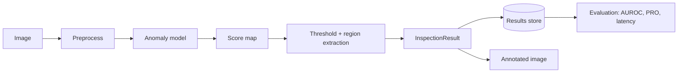

# VISTA

**Visual Inspection & Spatial Tracking Analytics**: find, localise and report defects in images of manufactured parts and materials.

> Status: early development. The pipeline below is the target design; this README tracks what actually works.

## What it does

Give VISTA an image of a part. It returns an anomaly score for the whole image, the regions it thinks are defective, and a structured inspection record you can store, audit and evaluate against ground truth.

## Architecture



Every stage exchanges data as an `InspectionResult` ([`src/vista/schema.py`](src/vista/schema.py)), validated at the boundaries.

## Roadmap

- [x] Repo tooling: lint, tests, CI
- [x] Inspection result schema
- [x] Dataset preparation (MVTec AD)
- [ ] Baseline anomaly model (PatchCore, see [ADR 0001](docs/decisions/0001-baseline-model.md))
- [ ] Evaluation harness (image AUROC, pixel AUROC, PRO, latency)
- [ ] Inference API
- [ ] Web demo

## Development

```bash
python -m venv .venv && source .venv/bin/activate
pip install -e ".[dev]"
ruff check . && pytest
```

## Data

We benchmark on [MVTec AD](https://www.mvtec.com/company/research/datasets/mvtec-ad), which is licensed **CC BY-NC-SA 4.0** (non-commercial). The dataset is not redistributed in this repository; only manifests and preparation scripts are.

## Team

Built by [V2GWorks](https://github.com/V2GWorks).

## Licence

Code: Apache-2.0. Datasets keep their own licences.
